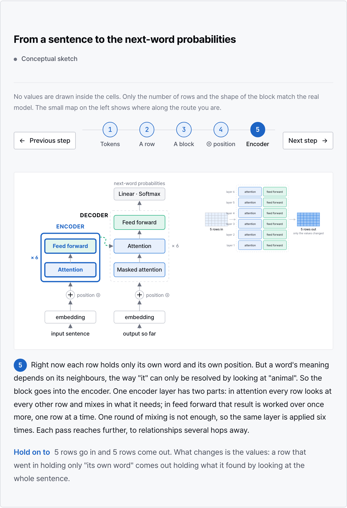
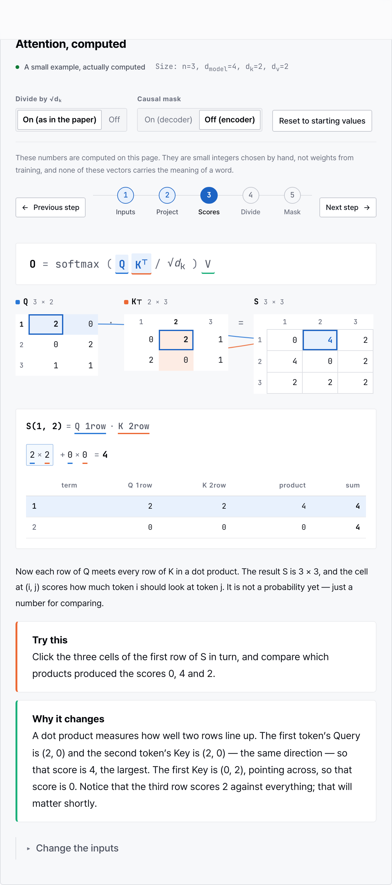
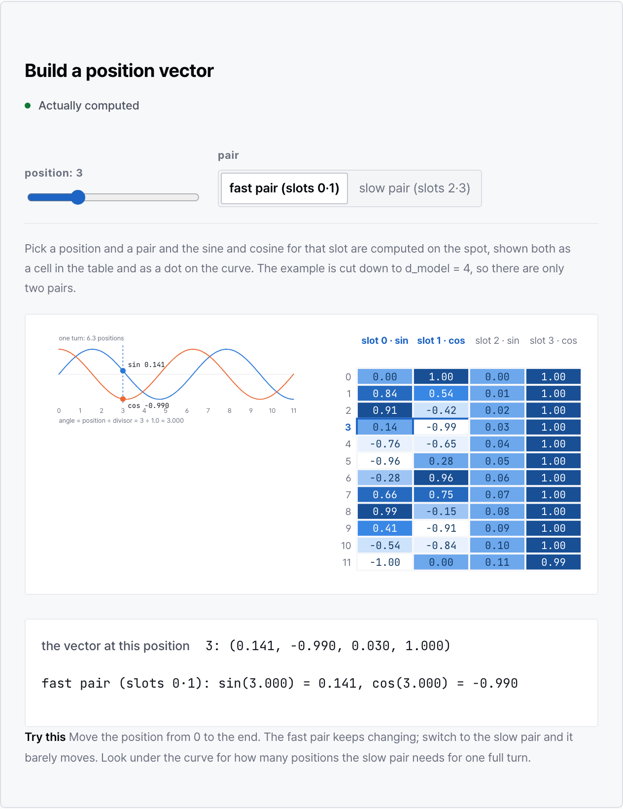

# LLM Visual Lab

A gradual introduction to LLM principles through small numerical experiments, using
*Attention Is All You Need* and a bridge to decoder-only language models.
Work a small example, change a value, then open the calculation behind it. Korean and English.



## What's covered

The article builds a small machine that guesses the next word, one part at a time. Each
chapter starts where the machine so far fails and adds the part that fixes it. Its words
carry four named slots (past, future, person, verb), so every number can be read.
Each chapter shows its result first; the calculation behind it waits in a closed
“숫자로 확인하기 / Check the numbers” fold. Seven chapters in three stages:

1. **The next-word game**: an LLM gives every possible next word a probability (try “어제/내일 학교에 ___”, “Yesterday/Tomorrow I ___”) → words become vectors with named slots.
2. **Reading context**: the last word alone ties “갔다/went” and “간다/will” at 31.7% → attention takes 89.3% from the earlier word and breaks the tie at 88.1%, and each position reads only earlier words.
3. **Writing and learning**: greedy, sampling, temperature and the loop that stops at the end marker → training pairs, loss and one update (37.9% → 50.0%) → how a real LLM stacks blocks, grows and who sets its numbers.

Three companion pages sit beside the article, and every chapter links into them:

- **In numbers** (`/ko/walkthrough/`, `/en/walkthrough/`): the previous article, ten units
  following one decoder run on two inputs in full numbers.
- **Lab** (`/ko/lab/`, `/en/lab/`): the editable experiments on a three-chunk sentence.
- **Paper** (`/ko/paper/`, `/en/paper/`): the original translator, its training setup and results.

Maths help belongs to the calculation that needs it: native, initially closed disclosures
show actual numbers and connect them to notation. There is no front-loaded symbol dictionary.
Old anchors such as `#problem`, `#numbers` and `#multi-head` still work; an anchor whose
content moved to the walkthrough, lab or paper page forwards there.

Experiments compute from explicitly hand-chosen inputs. IDs in conceptual illustrations
and prefix probability tables are illustrative; benchmark values come from the paper.
The tiny decoder is a one-block, post-norm illustration, not a trained GPT or full translator.
The lab page's one-block decoder uses X+PE without the paper’s embedding rescaling and an identity vocabulary readout. The walkthrough's two-input lesson omits position addition by default, keeps the causal mask on, and uses diag(−1, 1, 1, 1) as its vocabulary readout. Its optional position extension recomputes downstream values from X+PE. The training experiment really updates one coefficient and recomputes
loss; it does not implement backpropagation through an entire LLM.

## Try it

The attention lab computes equation (1) from inputs you can edit. Click a result cell to
see which row and column produced it and the products that add up to it.



Other experiments let you retrieve an embedding row by ID, append next tokens, follow one
input through attention and a complete block, update one coefficient, and compare greedy
with sampling on the same logits. Existing controls for positions, normalization, residuals,
loss, beam width and benchmark tables remain.

In the learning experiment input 1, 0 and −1 reveal why a learned weight is a multiplication
coefficient, rather than an attention share or a fixed label of importance.



Works in light and dark, on phones, and reads without JavaScript (the static build
includes the default state of every experiment).

## Run

```bash
npm install
npm run dev          # http://localhost:4321/llm-visual-lab/
npm run build
npm run preview

npm test             # math (vitest)
npm run typecheck
npx playwright install chromium && npm run test:e2e
```

## Layout

- `src/content/docs/{ko,en}/index.mdx` – the article text; `walkthrough.mdx`, `lab.mdx` and `paper.mdx` – the companion pages
- `src/lib/math/story.ts` and `src/components/story/` – the article's readable next-word machine and its figures
- `src/lib/math/` – pure functions; everything on screen comes from these
- `src/components/lab/` – React experiments
- `src/components/site/` – SVG figures, rendered at build time from the same math
- `src/lib/i18n/` – strings in both languages
- `src/lib/paper.ts` – numbers transcribed from the paper (the only ones not computed here)
- `tests/unit/`, `tests/e2e/` – math against numpy-generated fixtures; browser checks at desktop and phone width

## Paper

Vaswani et al., *Attention Is All You Need*, [arXiv:1706.03762](https://arxiv.org/abs/1706.03762) (v7).
`docs/papers/` lists which parts are worked through and which are only named.
